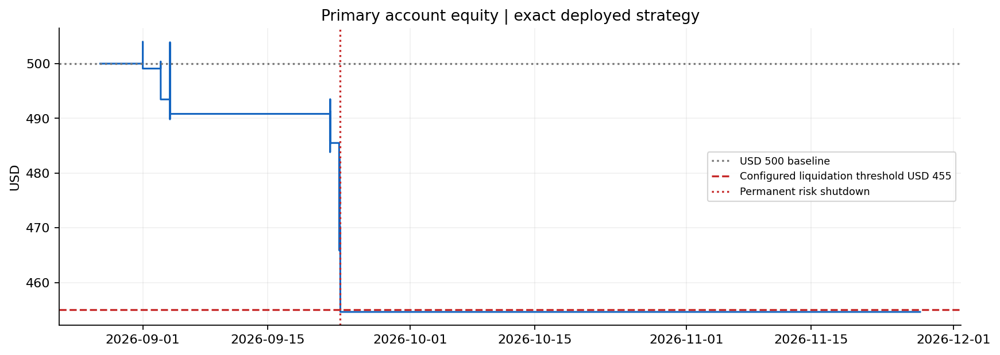
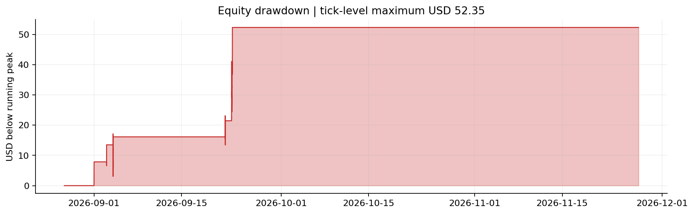
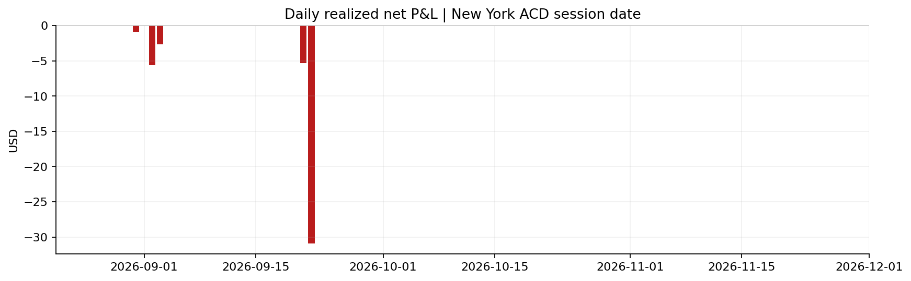
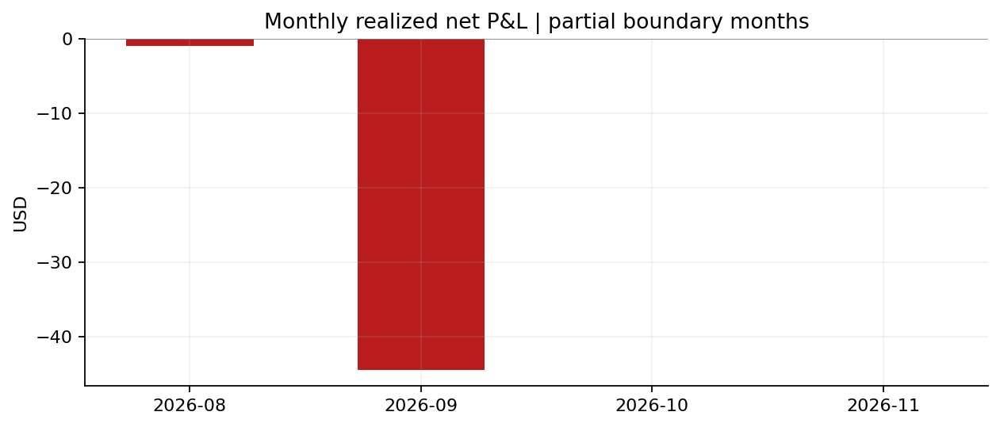
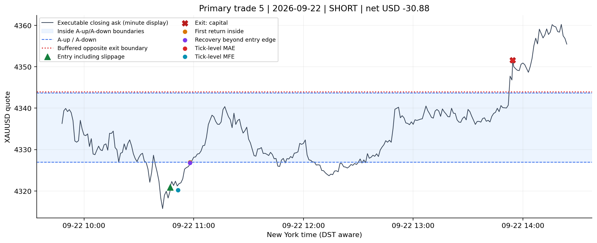
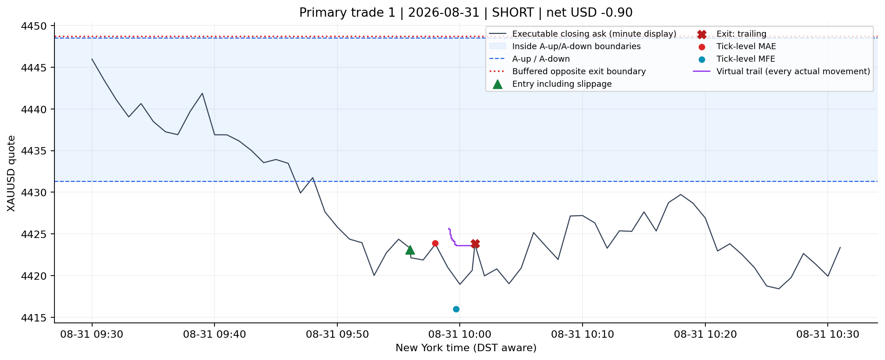
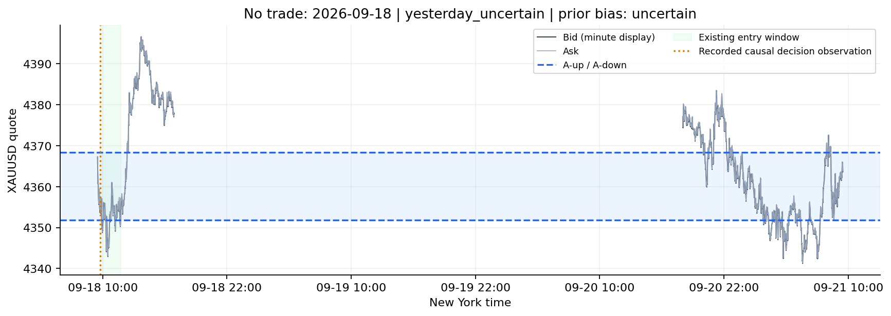
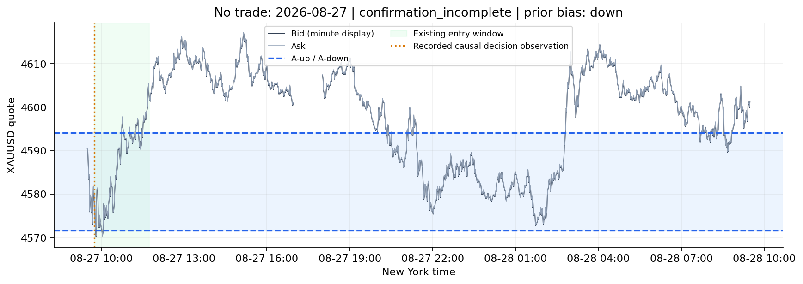
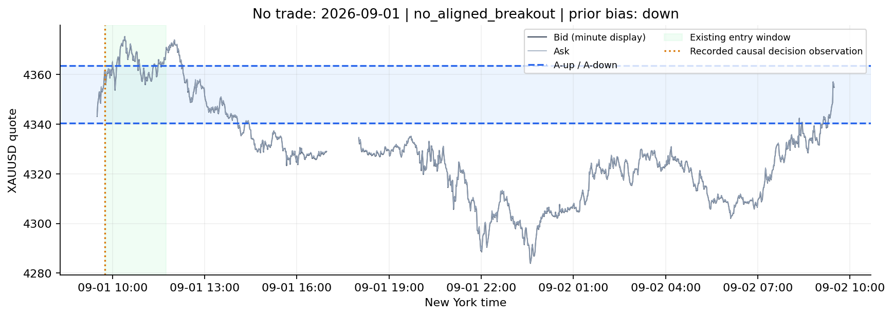
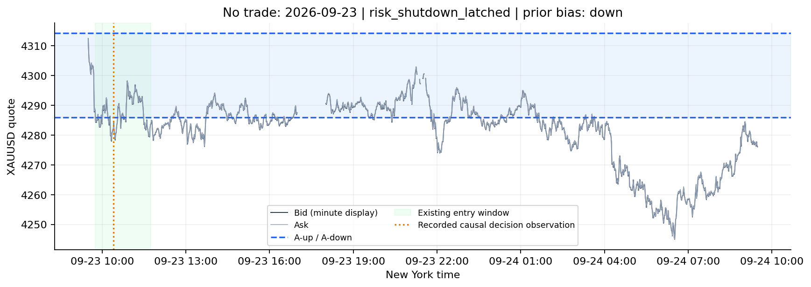

# ACD continuation robot — Phase 2 validation

27 November 2026. Research only; the active EC2 robot, configuration, equity, ledger, raw tick collection and unrelated services were preserved. No live execution was enabled and no strategy optimization was performed.

## Current paper robot

Snapshot: **2026-11-27T09:22:06.052996+11:00** (Sydney). Paper equity **USD 500.00**, realized P&L **USD 0.00**; **0 ledger events**, **0 entries**; position **none**; paused **True**, risk latch **False**.

Last accepted quote: `2026-11-27T06:29:59.982000+11:00`. Pending control: **True**. The primary service, watchdog timer, raw collector and existing web service are running. The watchdog is logging stale-feed errors and has queued a close/pause; there is no exposure to liquidate. Calendar closure versus feed outage is unverified. The pause was not overridden.

Isolation is verified by unchanged source hashes, paper-only configuration validation, the unit command and the call graph: the service imports the database reader and paper engine, with no broker order or authentication path. `status_before.json` and `status_after.json` preserve read-only evidence. No active restart/control/config write was performed in Phase 2.

## Strategy compliance

The implementation enforces one entry per New York ACD session, matches a causal confirmed A breakout to the frozen previous-session bias, permits range retracement and does not invalidate solely on re-entry. Low frequency and floating drawdown were preserved. Existing trailing, capital and timed exits remain independent overrides.

**Opposite-edge ambiguity:** the deployed exit requires a 0.25 quote buffer plus a 450-second hold. It does not invalidate on the first boundary break. This matches the original break-and-hold mandate but may conflict with an immediate-break interpretation of the latest clarification. No active change was made. The owner has not yet accepted the candidate numeric bias/edge/confirmation definitions.

Full recovered rules, causal proof, discrepancies and unresolved definitions: [STRATEGY_AUDIT.md](STRATEGY_AUDIT.md).

## Primary historical account

Window: **2026-08-27T05:29:59.982000+10:00 to 2026-11-27T06:29:59.982000+11:00** (Sydney display) — three calendar months anchored in UTC, ending at the latest available quote when the run began. Ten preceding days were used for no-entry warmup. **16,235,560 full-resolution valid ticks** were processed in the window; **1,503 equal-timestamp quotes** were skipped over the full warmup+evaluation stream, following deployed semantics; **0 invalid quotes**. Execution, excursions and maximum drawdown use full ticks; only chart rendering is downsampled.

The primary starts once at USD 500, using the unchanged 0.01 lot sizing, ACD, entry/exit/trailing and risk rules. The actual configured pre-limit liquidation threshold is USD 455 (USD 450 floor plus USD 5 buffer). The loss latch is never reset during evaluation. Later sessions are signal diagnostics only, with no hypothetical account trades or P&L.

**Scope:** this is an uninterrupted replay of the deployed strategy core, not a replay of service availability, watchdog control messages, restarts or execution latency. Core quote-gap timer resets are included. The active watchdog can pause trading through normal closures, so these historical trades must not be presented as trades the currently paused service would necessarily have taken.

| Measure | Primary result |
|---|---:|
| Scheduled weekday sessions | 67 |
| Observed quote sessions / trading days | 67 |
| Weekdays without quotes | 0 |
| Directional continuation days (including post-shutdown diagnostics) | 31 |
| Eligible signal days before account/risk gates | 31 |
| Executable eligible account days | 5 |
| Executed / closed trades | 5 / 5 |
| Winning / losing / breakeven trades | 0 / 5 / 0 |
| Realized net P&L (configured costs) | USD -45.38 |
| Ending marked equity | USD 454.62 |
| Net account change | USD -45.38 |
| Win rate | 0.00% |
| Profit factor | 0.00 |
| Expectancy per closed trade | USD -9.08 |
| Maximum tick-level equity drawdown | USD 52.35 |
| Maximum consecutive losses | 5 |
| Average holding duration | 0.89 hours |
| Maximum holding duration | 3.12 hours |
| One-trade-per-day violations | 0 |

### Loss shutdown

- Permanent latch: **2026-09-23T03:54:26.314000+10:00**, post-exit equity **USD 454.62**, configured trigger **USD 455.00**. No later account entry was allowed.

**This early-terminated trading account is the primary result.** The remaining historical ticks are retained for daily signal diagnostics, not for a reset or unconstrained performance curve.

### Long and short performance

| Side | Closed trades | Wins | Net USD |
|---|---:|---:|---:|
| Long | 2 | 0 | -8.28 |
| Short | 3 | 0 | -37.10 |

### Monthly realized performance

Boundary months are partial. Net P&L is assigned to the exit ACD session; ending equity also includes any floating P&L.

| Month | Observed days | Entries | Net USD | Ending equity USD |
|---|---:|---:|---:|---:|
| 2026-08 | 4 | 1 | -0.90 | 499.10 |
| 2026-09 | 22 | 4 | -44.48 | 454.62 |
| 2026-10 | 22 | 0 | 0.00 | 454.62 |
| 2026-11 | 19 | 0 | 0.00 | 454.62 |

### Retracement, invalidation and trailing

Of 5 primary trades, **1 returned inside A-down/A-up**, **1 subsequently recovered beyond their entry edge**, and **0 retracement trades closed profitably**. Recovery is a price event, not a guaranteed win.

**1** trades crossed the raw opposite A edge; **1** crossed the buffered edge. These are separate from a held structural invalidation. Exit reasons: `{"capital": 1, "trailing": 4}`. Every actual trail movement is in `trailing_movements.csv`.

Trailing activation does not guarantee a profitable exit under the specified mathematics. The frozen A edge can be well beyond the actual entry after the 450-second confirmation; halfway from that edge to the favorable extreme can still be on the loss side of entry. **4 of 4 trailing exits were net losses**, with **66 recorded trail updates**. This is a consequence of the existing edge-based formula, not a tighter stop introduced by Phase 2. Retracement recovery means recrossing the breakout edge, not necessarily regaining the entry price or recovering account equity.

## Costs, data and calendar limitations

Actual historical bid/ask spread is included (mean quote spread **0.12**, maximum **1.44**). Fixed adverse slippage is 0.10 quote USD per side and commission is USD 0.14 round trip at a hypothetical 100 oz/lot. Zero modeled swap is retained from the active configuration. **Broker contract, financing and fee schedules are not verified; these are configured paper net results, not proven realistic all-in broker results.** No parameters or cost scenarios were optimized.

The weekday clock yields **2 partial boundary sessions** and **2 sessions with incomplete end/window coverage**. `data_gaps.csv` records all gaps above 60 seconds. Holidays, early closures and missing feed data cannot be distinguished reliably from this database alone. `daily.csv` exposes calendar versus preceding observed session labels; the unchanged strategy does not correctly resolve all broker-calendar cases.

The observed primary result provides no positive economic justification for this candidate. It also cannot establish the intended strategy's profitability because definitions and implementation gaps remain. Further development should first resolve correctness, calendar and cost validation, then repeat validation without optimization; these results do not justify live execution.

## Visual evidence

## Representative examples

**Successful continuation:** not observed in the primary account. No fabricated or post-shutdown trade is substituted.

### Retracement and recovery: trade 5 (2026-09-22)

**Opposite boundary invalidation:** not observed in the primary account. No fabricated or post-shutdown trade is substituted.

### Opposite boundary breach: trade 5 (2026-09-22)

### Trailing stop exit: trade 1 (2026-08-31)

### Risk shutdown exit: trade 5 (2026-09-22)

### Code-consistent rejection: 2026-09-18

Reason: `yesterday_uncertain`. This is consistent with the deployed candidate; unresolved owner definitions are not thereby validated.

### Code-consistent rejection: 2026-08-27

Reason: `confirmation_incomplete`. This is consistent with the deployed candidate; unresolved owner definitions are not thereby validated.

### Code-consistent rejection: 2026-09-01

Reason: `no_aligned_breakout`. This is consistent with the deployed candidate; unresolved owner definitions are not thereby validated.

### Code-consistent rejection: 2026-09-23

Reason: `risk_shutdown_latched`. This is consistent with the deployed candidate; unresolved owner definitions are not thereby validated.

## Defects, unresolved definitions and risk

Reproduced defects: partial prior formation can produce a definite bias, and entry-tick equity omits immediate costs until the next quote. Calendar gaps affect prior-session identity and timed exits; closure-triggered pauses do not resume automatically. Opposite-break immediacy, the selected ACD variant, prior-move definition, trailing reference, entry window and trading-day meaning remain unresolved. See the full audit and regression fixtures. The active robot was not patched.

**USD 50 is not a guaranteed maximum loss.** There is no broker stop, verified isolated live allocation, broker execution recovery or off-host liquidation watchdog. Gaps, unavailable quotes and execution failure can exceed the software threshold. No live activation was attempted.

## Artifacts, tests and Git

- `summary.json`: exact configuration, window, counts, tick-level statistics and source hash.
- `daily.csv` / `daily.json`: every scheduled weekday, causal decision observation, ACD levels, gate reasons, entries, excursions, retracement, invalidation, exits and closing equity.
- `trades.csv` / `trades.json`: full primary trade history, charges and exact excursion/retracement timestamps.
- `trailing_movements.csv`: each trailing update; `equity_and_quotes.csv`: chart samples; `data_gaps.csv`: unresolved quote gaps.
- `charts/` and `examples.json`: every primary trade chart plus representative rejected days and performance plots.
- `status_before.json` / `status_after.json`: read-only forward-operation evidence; `frozen_source/`: unchanged calculation snapshot.
- [REPRODUCE.md](REPRODUCE.md): isolated rerun commands and field definitions; [STRATEGY_AUDIT.md](STRATEGY_AUDIT.md): compliance and unresolved requirements.

Validation: `python -m pytest test_acd_phase2_replay.py test_acd_continuation.py test_hlrtacd_acd.py -q` — **30 passed** in the working environment. **22/22 artifact/preservation checks passed**, including trade counts, P&L, trailing, shutdown and unchanged active configuration/source. The committed Phase 2-specific suite is independently runnable from the frozen snapshot. Syntax compilation of all research scripts passed. Charts were rendered and visually inspected.

Research branch: `codex/acd-phase2-validation`. The commit hash is returned with delivery; this report is part of that commit. Only research artifacts/scripts/tests were staged. No push to `main`, deployment or active parameter change was made.
