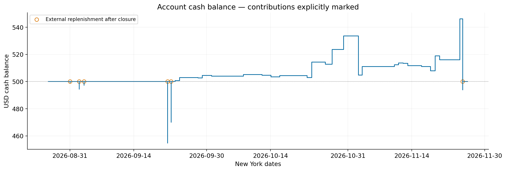
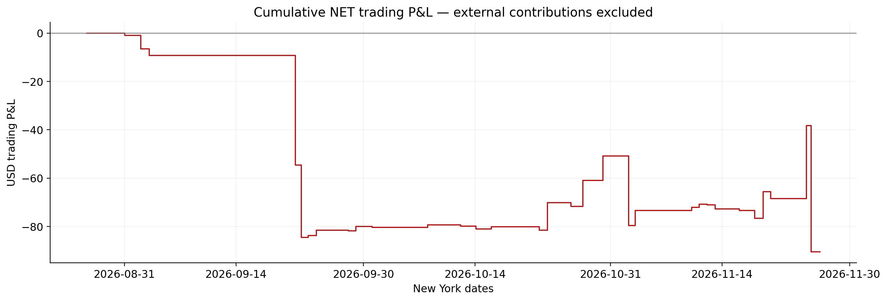
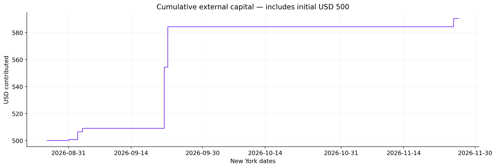

# ACD continuation — Phase 2 revised replay and visual verification

Research only. The original Phase 2 artifacts, active EC2 paper robot, raw collection and unrelated services are unchanged. No Phase 3, optimization, live execution or actual capital transfer occurred. All contributions below are simulated external capital.

## Revised money management

Start once with USD 500. After the core has fully closed a trade, add `max(0,500−closed balance)` as external capital. Retain any balance above 500. Only after closure and replenishment clear the risk latch. Never add capital to an open position; never clear the session entry allowance. Position size remains 0.01 lot.

**The existing absolute trigger is USD455**, calculated as the USD450 floor plus the configured USD5 pre-limit liquidation buffer. It is not reset to “entry balance minus45”. After replenishment to500 there is USD 45 of equity headroom before estimated execution costs; if profits leave balance 600, the same 455 trigger provides USD 145 headroom. Spread, fees, gaps and slippage can cause overshoot. No threshold, reserve, entry price rule or exit formula was changed.

The legacy engine represents cash as `500 + realized`. The adapter adds external capital to that internal cash offset, while independently accumulating trading P&L from closed-trade results. The contribution ledger and reconciliation checks prevent that internal field name from disguising deposits as profits.

## Same dataset and original-account control

Fixed interval: **2026-08-27T06:29:59.982000+11:00 → 2026-11-27T06:29:59.982000+11:00**, exactly the original Phase 2 endpoints, with the same ten-day warmup. Newer quotes do not move this window. Processed evaluation ticks: **16,235,560**. The original 31 signal dates and all raw/processed/duplicate counts match. Valid-stream SHA256: `e7ad2a5f2736f1deb90392af80d56891026b7832ca9bbd9976cea607ac12002b` (record encoding in `summary.json`). The previous run had no dataset hash; matching counts, 31 dates and control-account execution results are the available cross-run checks.

The original account was independently reprocessed on these same ticks until its permanent latch. Its **5 trades, USD-45.38 net and USD454.62 final equity reproduce exactly**, including entry/exit timestamps, prices and reasons. This control is in `baseline_comparison.json`. The revised run changes only the funding/latch policy; different cash headroom can change which existing risk exit fires, as well as allowing later trades.

All ACD calculations, weekday/DST clock, prior bias, current confirmation, entry window, 0.01-lot sizing, edge-based trailing half, opposite buffered/held exit and configured costs remain the same. Known Phase 2 correctness/calendar limitations were not silently fixed. This is an uninterrupted strategy-core replay, not historical service/watchdog availability or broker latency.

## Financial results — capital is not profit

| Measure | Original Phase 2 | Revised funding model |
|---|---:|---:|
| Continuation-signal days |31|31|
| Executed trades |5|31|
| Winning / losing / breakeven |0 /5 /0|13 /18 /0|
| Net trading P&L, excluding contributions |USD-45.38|**USD-90.51**|
| Replenishment count |0|6|
| Total replenishments |USD0.00|USD90.51|
| Total external capital, including initial 500 |USD 500.00|**USD590.51**|
| Final account balance |USD454.62|**USD500.00**|
| Profit factor |0.00|0.50|
| Expectancy per trade |USD-9.08|USD-2.92|
| Maximum individual loss |USD30.88|USD52.28|
| Maximum consecutive losses |5|5|

**Cash reconciliation: USD590.51 external capital + USD-90.51 trading P&L = USD500.00 final balance.** A funded ending balance near500 does not mean the strategy broke even.

Exit reasons: `{"capital": 1, "opposite": 3, "trailing": 27}`. Capital-protection events/reset records: **1**. Contributions-adjusted maximum equity drawdown: **USD108.12**, distinct from the cash account curve that includes funding.

## All 31 continuation-signal days

The table records every original signal day. A rejection based on risk shows the closest confirmed opportunity, not a newly invented filter. The unchanged estimate includes opposite-boundary distance at executable entry, configured costs/slippage and the USD5 delay reserve, and must be **strictly less** than equity−455. Full gate counts and precise numeric evidence are in `signal_day_investigation.json`/`.csv` and in the gallery.

| NY ACD date | Trade | Exact rejection evidence if not executed |
|---|---:|---|
|2026-08-31|1|—|
|2026-09-02|2|—|
|2026-09-03|3|—|
|2026-09-21|4|—|
|2026-09-22|5|—|
|2026-09-23|6|—|
|2026-09-24|7|—|
|2026-09-28|8|—|
|2026-09-29|9|—|
|2026-10-01|10|—|
|2026-10-08|11|—|
|2026-10-12|12|—|
|2026-10-14|13|—|
|2026-10-16|14|—|
|2026-10-22|15|—|
|2026-10-23|16|—|
|2026-10-26|17|—|
|2026-10-27|18|—|
|2026-10-30|19|—|
|2026-11-02|20|—|
|2026-11-03|21|—|
|2026-11-10|22|—|
|2026-11-11|23|—|
|2026-11-12|24|—|
|2026-11-13|25|—|
|2026-11-16|26|—|
|2026-11-18|27|—|
|2026-11-19|28|—|
|2026-11-20|29|—|
|2026-11-24|30|—|
|2026-11-25|31|—|

## Mandatory closure compliance

All positions fully closed at dataset end: **True**. No position carried into its next ACD formation: **True**. Strict deadline compliance: **True**. Only the four permitted exit types were observed.

No late-deadline or next-formation exposure violations occurred in this dataset. No unavailable-market execution prices were fabricated. This is dataset evidence, not a guarantee under future gaps/closures.

## Full-session visual evidence

[Open the complete HTML trade gallery](gallery.html) — **31 full-session PNGs and 31 secondary zooms**, in chronological order, with every requested summary embedded. [Download charts and summaries ZIP](charts_and_summaries.zip). [Trade summaries CSV](trade_summaries.csv). The gallery also embeds all 31 signal-day decisions; inspecting trades does not require opening CSV files.

Each full PNG begins at the previous ACD formation start and ends 30 minutes after completion of the next formation. It shows the complete prior and trading session, their formations and A boundaries, the prior directional classification and supporting first-ask/final-bid movement, today’s confirmation, exact entry/exit times and simulated execution prices, highlighted open-position line, every actual trailing movement, buffered opposite stop, deadline and next formation boundaries. Time uses New York EDT/EST and true elapsed spacing; weekend/closure gaps are blank, not compressed or interpolated.

The displayed line selects the actual last historical quote per second, using bid to close longs and ask to close shorts. All fills, confirmations, MAE/MFE and risk calculations use every valid tick. Exact execution prices include the unchanged slippage assumption and can differ from the plotted closing-side quote by spread/slippage. Context/formation coverage is checked in `chart_context_checks.json`. PNGs are at least 4000 pixels wide; secondary zooms never replace the full frame.

## Costs, limitations and interpretation

Costs remain historical bid/ask spread, 0.10 quote USD adverse slippage each side, USD0.14 round-trip commission, zero modeled swap and hypothetical 100oz/lot. These are unchanged, unverified broker assumptions. The weekday clock still lacks broker holidays, early-closure permissions and a validated financing schedule. The partial-prior-formation bias defect and entry-tick equity valuation delay identified in Phase 2 remain in the frozen core. No parameter search, tighter exit or new entry filter was introduced.

The half-trail remains anchored to the frozen A edge, not entry. Activation after a favorable USD3 quote move does not guarantee a profitable exit: a 50% edge-to-extreme level may still be beyond the loss side of a late entry. Replenishment permits later opportunities but cannot repair negative trading expectancy or remove virtual-exit/gap risk. The software capital threshold is not a guaranteed maximum loss, and retained profits expand headroom to the unchanged absolute 455 floor.

## Preservation and validation

Paper snapshot: 2026-11-26T23:08:43.837815+00:00; equity USD500.00, realized USD0.00, position `None`, paused `True`. Active source/configuration match the original deployment and before/after snapshots. Existing service, collector and watchdog timer remain active. The existing stale-quote pause was not overridden. The warning log retains earlier watchdog service failures; active service/timer status does not establish that the robot is ready to enter. No active ledger, capital, parameters or live order path was changed.

**34/34 integrity and visual checks passed.** The funding/closure and prior-regression suite passed 36 tests. The original account reproduces exactly on the same tick stream; the original Phase 2 directory has no Git diff. Visual samples were reviewed before delivery. See `checks.json`, `baseline_comparison.json`, `capital_contributions.csv`, `account_events.csv`, `daily.csv`, `trades.json` and `status_before.json`/`status_after.json`.

## Reproduction

Run `scripts/acd_phase2_revised_replay.py --reference docs/acd_continuation/phase2_2026-11-27 --config docs/acd_continuation/phase2_2026-11-27/config.json --output NEW_RESEARCH_DIRECTORY` with the unchanged snapshot/database integration on PYTHONPATH. The read-only database must retain the original window and warmup. Then run `scripts/acd_phase2_revised_visuals.py NEW_RESEARCH_DIRECTORY` and `scripts/acd_phase2_revised_deliver.py NEW_RESEARCH_DIRECTORY --reference docs/acd_continuation/phase2_2026-11-27` after placing read-only preservation snapshots in that directory.

The quote-per-second gzip is research support data retained separately on EC2; it is not included in Git or the downloadable gallery ZIP. It is reproducibly generated from the preserved raw database. Metadata, ledgers, reports, all PNGs, the offline gallery and ZIP are committed on `codex/acd-phase2-revised-validation`. No changes were pushed to main or deployed.
