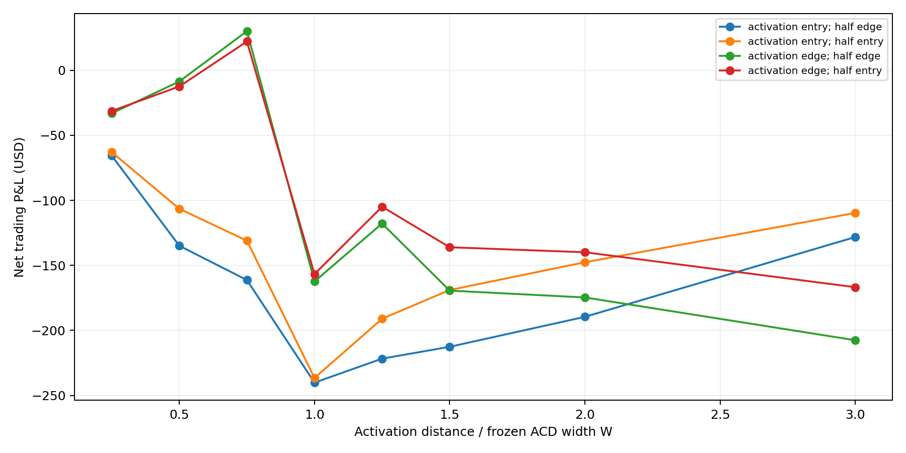
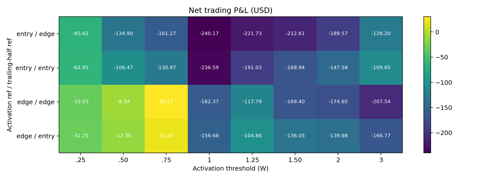
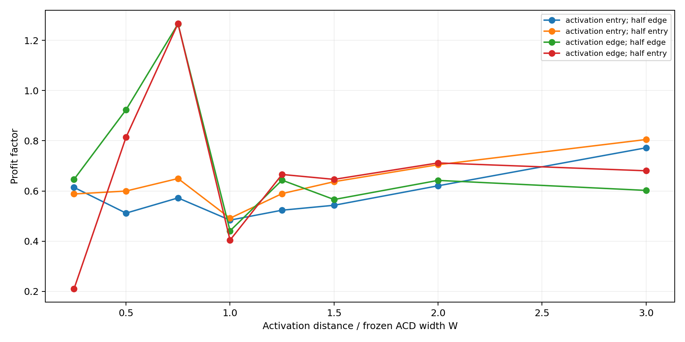
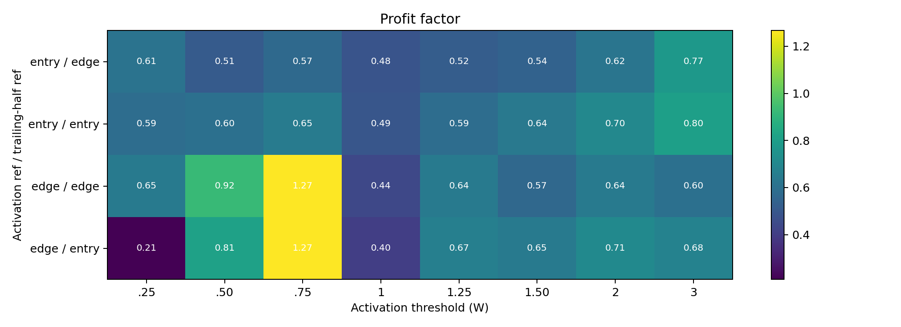
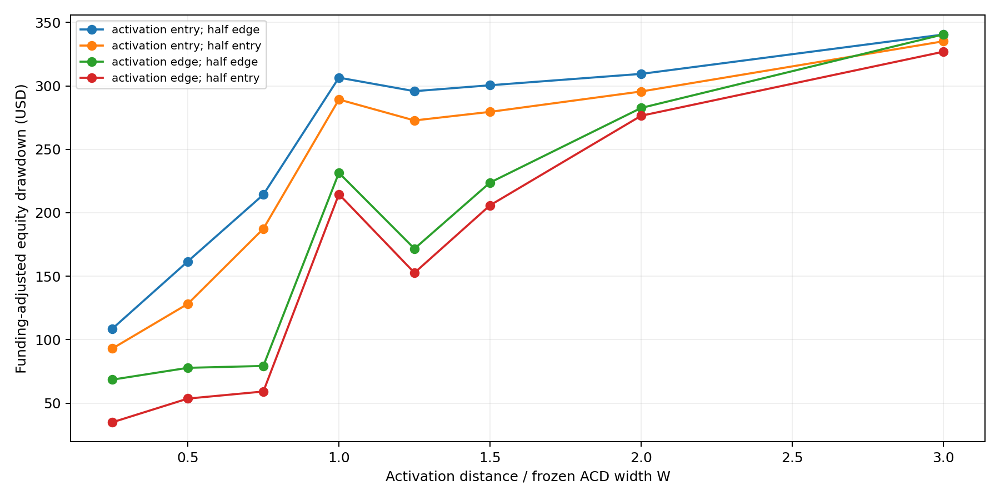
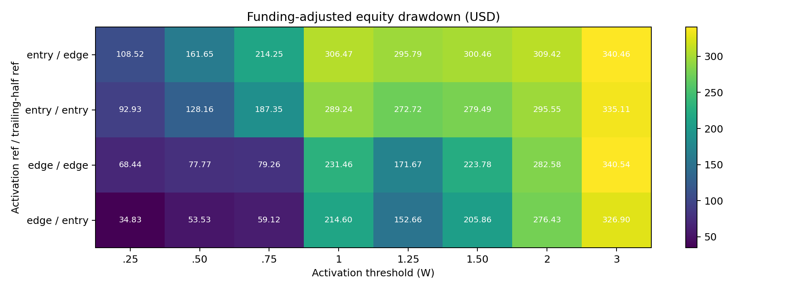
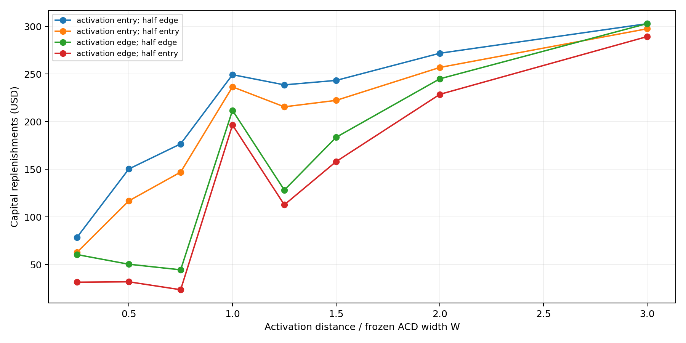
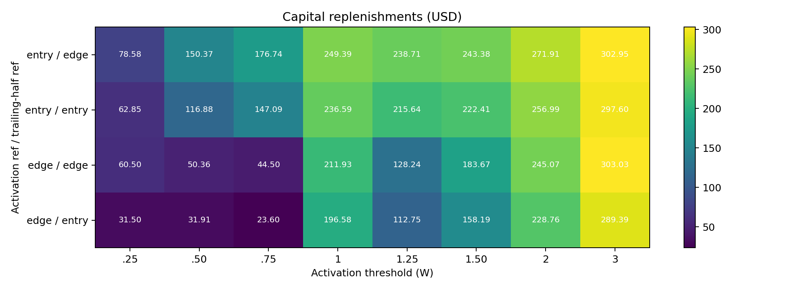

# ACD Continuation — Phase 3 exit strategy research

**Exploratory research only. No strategy was selected or deployed.** Active EC2 paper execution, raw collection and both Phase 2 result directories are preserved. All 55 accounts are independent simulations, starting with USD 500; contributions are external capital, never trading profit.

## Findings

Trade 2 confirms that an early trail can discard a later continuation. With one-width activation measured from entry, both half-trail anchors remained open to mandatory closure and earned USD 52.29 net, versus the baseline loss of USD 5.64. No opposite-boundary or capital protection event would have interrupted that holding path. The later 4470 move occurred after the mandatory deadline and is excluded. [Detailed trade 2 forensic report](TRADE2.md).

That example does **not** establish a generally better exit. One-width fixed targets and adaptive trails lose more than baseline across the full sample. No-trailing is also negative and requires more external capital. The narrow re-entry policy is positive in aggregate, but removing its best session reverses that result. There is no broad profitable adaptive-trailing region in this grid.

## Baseline and causal data validation

Fixed historical interval **2026-08-27T06:29:59.982000+11:00 → 2026-11-27T06:29:59.982000+11:00**, with the original warmup. All **16,235,560** evaluation ticks were processed. Stream SHA256 **`e7ad2a5f2736f1deb90392af80d56891026b7832ca9bbd9976cea607ac12002b`** matches revised Phase 2 exactly, including its warmup, duplicate-timestamp policy and counts. The cache is derived from a read-only database query; it never alters raw ticks.

The baseline reproduces all 31 entry/exit timestamps, prices, directions, reasons and per-trade P&Ls (floating arithmetic tolerance 1e-8). It reproduces 13 winners, 18 losers, USD −90.51 net and 27 trailing exits. Its six replenishments total USD 90.51. Alternative performance is accepted only after the baseline reproduction gate passes. An independent cache lookup additionally verified all 1,831 execution pairs, including all 49 already-reached targets at the next quote and every timed exit at its first available quote (xecution_checks.json).

ACD levels were independently recomputed from the formation’s historical midpoint extrema and unchanged offsets. Prior directional labels were checked against the completed preceding observed session, using first ask to final bid, original coverage/gap rules and the unchanged ±USD 3 classification. Boundary partial sessions are disclosed in `causal_source_checks.json`; they are not falsely claimed to have independently reconstructed missing warmup data. Frozen levels/bias become available causally before entry; exit decisions use executable bid for longs and ask for shorts.

## Frozen rules and experimental definitions

- **W = A-upper − A-lower**, frozen after the New York 09:30–09:45 formation. A edges use midpoint OR extrema ±0.75; C edges remain ±1 but do not create new exit filters.
- Initial entries retain the causal fresh-inside breakout and 450-second hold, the 120-minute post-formation window, three-hour late cutoff, fixed 0.01 lot / hypothetical 1 oz, and original risk-distance admission check. Each independent cash history can change risk admission and consequently the actual entry timestamp; entries are not artificially pinned to the baseline.
- Fixed targets use entry or directional edge ± multiple × W. The first subsequent executable quote at or beyond the target closes at that actual quote with adverse slippage. Earlier target touches are flagged. If already beyond target on entry, it is explicitly flagged and executed on the next available quote; no historical target price is fabricated. This convention was confirmed by the owner.
- Width-based trailing activates at **≥ multiple × W** from its independently specified entry/edge reference. Fixed-USD-3 controls preserve strict **> USD 3**. The 50% trailing equation independently uses edge or executed entry to the best subsequent closing-side quote, includes the entry quote as the initial extreme, and only tightens. Once active, trailing remains an independent exit, including during otherwise valid ACD retracement.
- An edge-referenced activation can already have been crossed when a later executed entry occurs; it need not imply that the actual position is profitable. Such a trail can activate on the first post-entry quote. This is an explicit tested reference convention, not an assertion of a guaranteed profitable trail.
- Pullback exits use bid ≤ upper A edge for longs, ask ≥ lower A edge for shorts. A fresh 450-second confirmation is required after full closure; the closing inside quote can arm that fresh observation, while gaps >60 seconds erase arming. No same-tick exit/re-entry or simultaneous positions. Policy A preserves the original entry window for every entry; policy B preserves it for the first entry and permits re-entries until the next formation minus three hours. No extra filter was added.
- Opposite stops preserve the existing buffered boundary (0.25 beyond the opposite A edge) and 450-second continuous hold. They are evaluated while a position is open, as in the original core. A pullback exit often pre-empts this structural exit; flat positions do not acquire an invented session-wide opposite-boundary ban.
- Mandatory closure remains next weekday ACD formation minus one hour. Capital protection remains **absolute equity USD 455 = 450 + 5 buffer**. Capital/deadline precede discretionary exits; opposite hold is checked afterward, preserving baseline precedence. All positions settle before any top-up, profits above 500 are retained, and only then is the risk latch reset. Larger retained profits increase headroom above the same absolute 455 floor.
- Costs: historical bid/ask spread, 0.10 adverse quote slippage per side, 0.14 round-trip commission, zero modeled swap, unchanged 5 delay reserve for admission. Cost columns separately show commission, slippage and entry spread; their sum measures cost versus the closing-side quote path. These remain unverified broker assumptions.

## Primary comparison

References in names are `activation / trailing-half` for trails and `target reference` for targets. Expectancy/session divides net P&L by all 67 observed ACD sessions, including the two partial boundary sessions. Expectancy on entered sessions is a separate column in the full export. Multiple-entry variants are compared on net and session expectancy, not rewarded for trade count.

| Configuration | Trades | Net USD | PF | Net / ACD session | Replenishments | External capital incl.500 | Final balance | Funding-adjusted max DD |
|---|---:|---:|---:|---:|---:|---:|---:|---:|
|baseline|31|-90.51|0.496|-1.35|90.51|590.51|500.00|108.12|
|target_entry_1W|31|-219.78|0.531|-3.28|246.70|746.70|526.92|277.55|
|target_edge_1W|31|-114.40|0.564|-1.71|165.84|665.84|551.44|177.12|
|trail_entry_edge_1W|31|-240.17|0.484|-3.58|249.39|749.39|509.22|306.47|
|trail_edge_edge_1W|31|-162.37|0.441|-2.42|211.93|711.93|549.56|231.46|
|trail_entry_entry_1W|31|-236.59|0.491|-3.53|236.59|736.59|500.00|289.24|
|trail_edge_entry_1W|31|-156.68|0.404|-2.34|196.58|696.58|539.90|214.60|
|reentry_A|46|53.67|1.162|0.80|208.29|708.29|761.96|218.89|
|reentry_B|142|-68.77|0.902|-1.03|265.42|765.42|696.65|364.87|
|no_trailing|31|-92.17|0.839|-1.38|326.13|826.13|733.96|363.64|

**Financial identity for every configuration:** final cash = initial USD 500 + subsequent external contributions + net trading P&L. A positive ending balance above 500 can coexist with negative trading P&L. Replenishments are recorded only after closure. Funding-adjusted account equity is cash equity minus cumulative subsequent contributions; maximum account drawdown uses its full tick path, including final slippage. Intraday drawdown uses the actual cash-equity path within each ACD session, so it is a distinct measure and can include replenishment jumps.

The [complete 55-configuration table](comparison.csv) includes every requested metric: trade/session expectancy, win rate, entries, maximum loss, both drawdowns, loss streak, funding, final cash, duration, costs, exit distribution and closure violations. [Monthly breakdown](monthly.csv), [long/short breakdown](long_short.csv), [daily diagnostics](daily.csv), [all trades](all_trades.csv), [per-configuration trade files](trade_records/), [capital ledger](capital_contributions.csv). Exact trail movements are retained in `all_trades.json`.

## Sensitivity, concentration and candidate scope

Entry-referenced activation is negative at every tested width under both half-trail anchors. Edge-referenced activation is positive only at 0.75W, surrounded by negative 0.50W and 1.00W results. Thus the apparent 0.75W maximum is an isolated historical result, not a broad stable region. Later activation can allow larger adverse moves and capital exits before recovery.

| Positive-sample configuration | Net USD | Without best session | Without best two sessions |
|---|---:|---:|---:|
|target_edge_0.5W|0.27|-11.64|-19.79|
|target_edge_0.75W|63.64|45.30|31.53|
|trail_edge_edge_0.75W|30.17|-0.05|-17.44|
|trail_edge_entry_0.75W|22.20|9.40|-2.48|
|reentry_A|53.67|-85.91|-181.44|

The 0.75W edge fixed target remains positive after removing its two best sessions, but its neighbors are near-zero (0.50W) and materially negative (1.00W). The two 0.75W adaptive variants weaken or reverse when the strongest sessions are removed. Re-entry A depends heavily on one or two large sessions; extending re-entry to policy B increases churn, costs and drawdown and is negative. These are diagnostic removals, not executable account replays or out-of-sample tests.

**Candidates for a separately frozen, independent validation sample:** compare the edge-referenced fixed-target neighborhood 0.50/0.75/1.00W as a family, alongside baseline and no-trailing controls. Include edge-activation half-trails at 0.50/0.75/1.00W with both half anchors to test whether the isolated 0.75W result persists. Retain re-entry A only as a concentration-sensitive research comparator. Do not choose a single historical winner or authorize deployment from this grid. No robust profitable adaptive region has been established.

## Repeated breakouts and costs

| Policy | Trades | Entered sessions | Pullback exits | Repeated false breakouts | Net / session | Commission | Slippage | Entry spread |
|---|---:|---:|---:|---:|---:|---:|---:|---:|
|reentry_A|46|31|40|12|0.80|6.44|9.20|5.28|
|reentry_B|142|31|127|99|-1.03|19.88|28.40|15.96|

A repeated false breakout is a re-entry (session trade number >1) subsequently closed by the return-inside pullback rule. Total pullback exits also include failed initial entries. All costs remain included in trading P&L.

## Mandatory closure and market data gaps

No configuration carried an open position into its next ACD formation. There are **133 configuration/trade deadline-delay records** (the same underlying session can appear across configurations); maximum delay **0.298000 seconds**. **0** records cross a quote gap over 60 seconds. Strict timestamp deadline compliance is therefore not universal. Every late execution uses the first available actual quote, never a fabricated deadline fill. See [every deadline event](deadline_events.csv).

Weekday/New York DST session definitions are unchanged; no broker holiday or early-close calendar was invented. Weekend closures and source gaps are present on the true time axis. This three-month data stream cannot prove whether a particular long gap represents a market closure, a broker outage or missing collection. The software deadline and USD 455 stop are not guaranteed fill prices under gaps.

## Full-session visual evidence

[Open the complete side-by-side gallery](gallery.html). Every one of the 31 baseline signal sessions has ten panels: baseline, entry/edge one-width targets, all four one-width activation/half-reference combinations, both re-entry policies and no-trailing. All panels in a session share identical time and price scales and the same executable-side quote line. The frame begins at the previous formation and extends 30 minutes beyond completion of the next formation. Target and activation levels are included in the common full-frame price scale even if not reached. Short baseline trades receive secondary early-entry zooms; these never replace full-session charts.

The display selects the actual last historical quote each second and leaves gaps over 60 seconds blank. Every valid tick drives entries, extrema, exits, risk and performance. Formations, A edges, target/activation levels, actual trailing steps, all entries/exits and open-position portions are shown. Expand gallery records for every exact New York execution and contribution. [Download charts and full records](research_charts_and_records.zip).

## Preservation, checks and limitations

**23/23 delivery checks passed; 25 tests passed.** Tests include an independent scalar tick loop against all 55 exit configurations in long/short randomized paths, causal fresh-breakout/gap checks and prior funding/baseline regressions. Baseline reproduction is in `baseline_reproduction.json`; source causality checks are in `causal_source_checks.json`.

Paper snapshot at 2026-11-27T01:03:38.422942+00:00: equity USD 500.00, open position `None`, paused `True`. Source/configuration hashes and existing event history are preserved; paper mode and disabled broker-order path remain verified. Primary service, watchdog timer, collector and application remain active. The pre-existing pause and watchdog error history were not changed. No active parameter, balance or live execution path was modified.

The prior partial-formation directional classification defect, delayed entry-tick cost valuation, weekday-only calendar and stale-quote service-pause behaviour remain outside this exit experiment. This is an uninterrupted strategy-core simulation, not a claim that the paused production service would have executed these trades. Finite three-month historical parameter comparisons have selection bias and no independent predictive validation. Liquidity, gaps, financing, latency and contract specifications remain incomplete broker assumptions.

## Reproduction and artifact scope

`scripts/acd_phase3_research.py extract` regenerates the exact full-tick binary session cache from the read-only database and verifies the revised Phase 2 hash. `run` evaluates all independent accounts; `verify` independently checks every recorded execution against the cache and writes `execution_checks.json`. `scripts/acd_phase3_visuals.py` generates charts, gallery and forensics; `scripts/acd_phase3_deliver.py` reconciles funding, writes this report and packages downloads. See the scripts’ `--help` arguments. The support cache and prior quote-per-second gzip remain on EC2 under isolated research directories and are excluded from Git. All tabular results, full trade/trail data, charts, gallery, ledgers and research ZIP are committed on `codex/acd-phase3-exit-research`.
