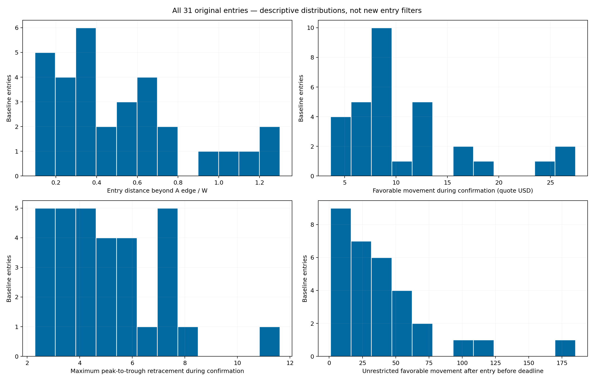
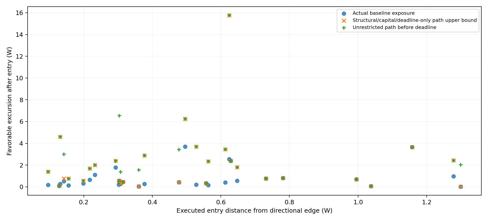

# Baseline entry forensic analysis

All 31 entries are included below. Median executed distance is 0.4773W; 6 entries execute at or beyond 0.75W. Actual hold ranges from 450.000 to 453.781 seconds because execution waits for available quotes and risk admission.

The first fresh aligned breakout can fail before the continuous run that produces the actual entry. Both timestamps and quotes appear in [complete baseline diagnostics](baseline_forensics.csv). Confirmation movement uses the executable closing quote from the start of the actual continuous entry run. Retracement is maximum peak-to-trough adverse movement during that run. Entry uses the opposite side of the spread plus adverse slippage. Structural stop distance includes the original 0.25 buffer; it is not a new stop.

Actual MFE ends at the baseline exit. Structural-only MFE is a separate counterfactual from the same entry and pre-entry account balance, ending at the earliest original capital, held opposite-boundary or mandatory exit. Unrestricted MFE ignores exits but ends at the mandatory deadline. These extrema are descriptive upper bounds, not achievable fills. A separate field extends unrestricted movement to the next formation; it is never treated as executable reward.

| # | NY session | Side | W | Entry / W | Hold s | Confirm MFE | Confirm retrace | Actual MFE | Structural-only MFE | Unrestricted MFE | First return NY |
| --- | --- | --- | --- | --- | --- | --- | --- | --- | --- | --- | --- |
| 1 | 2026-08-31 | down | 17.19 | 0.48 | 450.07 | 11.69 | 5.68 | 7.11 | 7.11 | 58.71 | 2026-08-31T10:36:30.814-04:00 |
| 2 | 2026-09-02 | up | 24.02 | 0.56 | 450.17 | 16.23 | 4.02 | 3.57 | 56.15 | 56.15 | 2026-09-02T10:47:02.000-04:00 |
| 3 | 2026-09-03 | up | 16.14 | 1.00 | 450.19 | 16.34 | 2.94 | 11.35 | 11.35 | 11.35 | 2026-09-03T13:03:01.432-04:00 |
| 4 | 2026-09-21 | down | 17.08 | 1.30 | 453.78 | 25.58 | 7.79 | 0.19 | 0.19 | 34.55 | 2026-09-21T11:06:30.549-04:00 |
| 5 | 2026-09-22 | down | 16.74 | 0.36 | 450.17 | 11.76 | 7.19 | 0.64 | 0.64 | 26.08 | 2026-09-22T10:57:57.770-04:00 |
| 6 | 2026-09-23 | down | 28.36 | 0.10 | 450.20 | 7.85 | 5.53 | 5.18 | 39.21 | 39.21 | 2026-09-23T10:32:32.294-04:00 |
| 7 | 2026-09-24 | down | 11.65 | 0.22 | 450.29 | 5.66 | 4.22 | 7.66 | 19.58 | 19.58 | 2026-09-24T10:27:49.617-04:00 |
| 8 | 2026-09-28 | down | 16.47 | 0.73 | 450.19 | 12.49 | 2.73 | 12.61 | 12.61 | 12.61 | 2026-09-28T12:25:05.577-04:00 |
| 9 | 2026-09-29 | up | 12.22 | 0.14 | 450.08 | 4.96 | 3.90 | 6.38 | 9.25 | 36.54 | 2026-09-29T10:37:02.890-04:00 |
| 10 | 2026-10-01 | down | 14.80 | 0.31 | 450.01 | 6.71 | 7.06 | 4.16 | 4.16 | 20.44 | 2026-10-01T10:20:56.334-04:00 |
| 11 | 2026-10-08 | up | 11.22 | 0.30 | 450.24 | 5.50 | 3.47 | 6.27 | 6.27 | 73.52 | 2026-10-08T10:39:49.992-04:00 |
| 12 | 2026-10-12 | down | 7.33 | 0.65 | 450.13 | 9.54 | 7.40 | 4.15 | 13.26 | 13.26 | 2026-10-12T10:37:08.412-04:00 |
| 13 | 2026-10-14 | down | 19.08 | 0.30 | 450.01 | 9.35 | 4.63 | 3.90 | 9.88 | 9.88 | 2026-10-14T13:30:26.435-04:00 |
| 14 | 2026-10-16 | up | 23.93 | 0.20 | 450.00 | 9.17 | 7.31 | 7.30 | 13.23 | 13.23 | 2026-10-16T11:14:39.437-04:00 |
| 15 | 2026-10-22 | down | 22.31 | 0.38 | 450.12 | 9.19 | 5.45 | 6.03 | 64.07 | 64.07 | 2026-10-22T10:40:11.288-04:00 |
| 16 | 2026-10-23 | down | 9.38 | 1.16 | 450.26 | 11.60 | 3.10 | 34.16 | 34.16 | 34.16 | 2026-10-26T04:51:41.888-04:00 |
| 17 | 2026-10-26 | down | 11.76 | 0.56 | 450.08 | 7.94 | 3.26 | 3.99 | 3.99 | 3.99 | 2026-10-26T10:04:52.106-04:00 |
| 18 | 2026-10-27 | up | 12.64 | 0.63 | 450.00 | 9.33 | 4.51 | 30.11 | 30.11 | 30.11 | 2026-10-27T10:21:27.064-04:00 |
| 19 | 2026-10-30 | down | 23.95 | 0.23 | 450.17 | 7.51 | 4.83 | 26.27 | 47.70 | 47.70 | 2026-10-30T09:58:38.195-04:00 |
| 20 | 2026-11-02 | up | 20.57 | 0.13 | 450.08 | 3.63 | 2.29 | 1.61 | 1.61 | 1.61 | 2026-11-02T12:15:39.085-05:00 |
| 21 | 2026-11-03 | down | 8.84 | 0.29 | 450.05 | 5.67 | 3.80 | 15.62 | 21.15 | 21.15 | 2026-11-03T20:14:02.721-05:00 |
| 22 | 2026-11-10 | down | 25.49 | 0.31 | 450.20 | 9.11 | 5.59 | 11.29 | 11.29 | 11.29 | 2026-11-10T13:44:33.879-05:00 |
| 23 | 2026-11-11 | down | 22.12 | 0.13 | 450.09 | 5.16 | 4.91 | 5.98 | 101.53 | 101.53 | 2026-11-11T10:35:42.874-05:00 |
| 24 | 2026-11-12 | down | 20.59 | 0.78 | 450.08 | 18.47 | 4.80 | 16.39 | 16.39 | 16.39 | 2026-11-12T11:55:33.587-05:00 |
| 25 | 2026-11-13 | down | 13.07 | 0.61 | 450.09 | 8.31 | 2.62 | 5.15 | 44.97 | 44.97 | 2026-11-13T11:35:23.222-05:00 |
| 26 | 2026-11-16 | down | 23.53 | 0.16 | 450.14 | 5.62 | 2.48 | 3.08 | 17.94 | 17.94 | 2026-11-16T11:57:20.249-05:00 |
| 27 | 2026-11-18 | down | 16.62 | 0.53 | 450.14 | 9.61 | 4.04 | 3.31 | 61.36 | 61.36 | — |
| 28 | 2026-11-19 | down | 11.73 | 0.62 | 450.11 | 9.06 | 3.42 | 29.82 | 185.05 | 185.05 | — |
| 29 | 2026-11-20 | down | 16.28 | 1.28 | 450.09 | 24.53 | 7.63 | 15.67 | 39.66 | 39.66 | 2026-11-20T10:39:36.181-05:00 |
| 30 | 2026-11-24 | down | 19.03 | 0.50 | 450.00 | 11.66 | 6.46 | 70.50 | 118.84 | 118.84 | — |
| 31 | 2026-11-25 | down | 19.89 | 1.04 | 450.17 | 27.44 | 11.61 | 0.99 | 0.99 | 0.99 | 2026-11-25T10:36:24.698-05:00 |

The CSV includes first-return price, actual entry/exit timestamps, 0.5/0.75/1/1.5/2/3W first-hit times and raw opposite-boundary ordering both from first breakout and after execution. Hindsight reward/structural-risk ratios are diagnostics only; they are not admission criteria.
