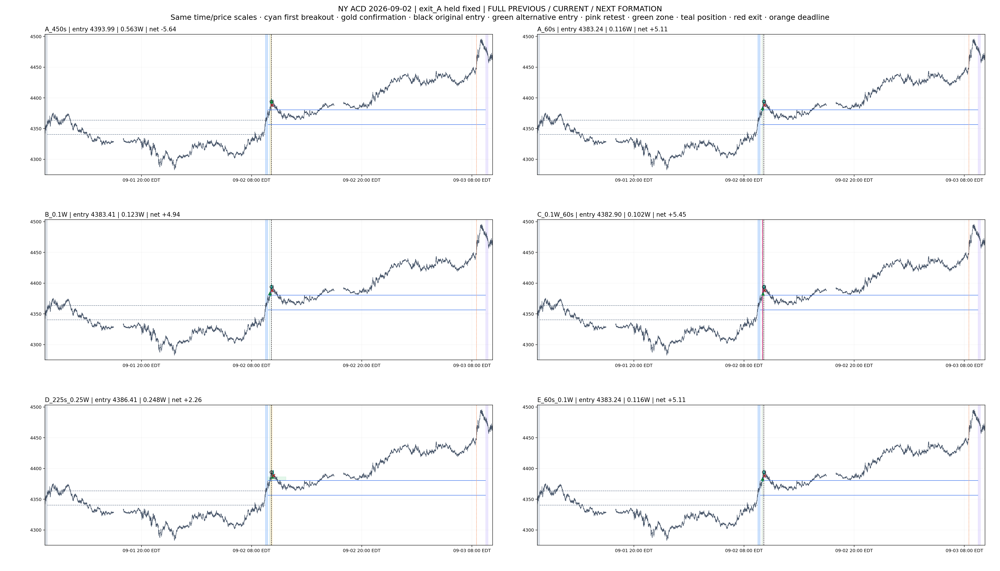
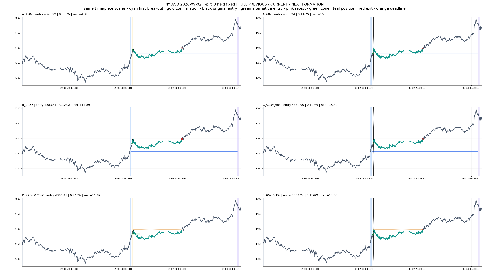
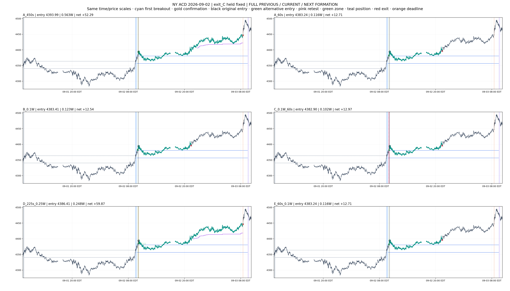
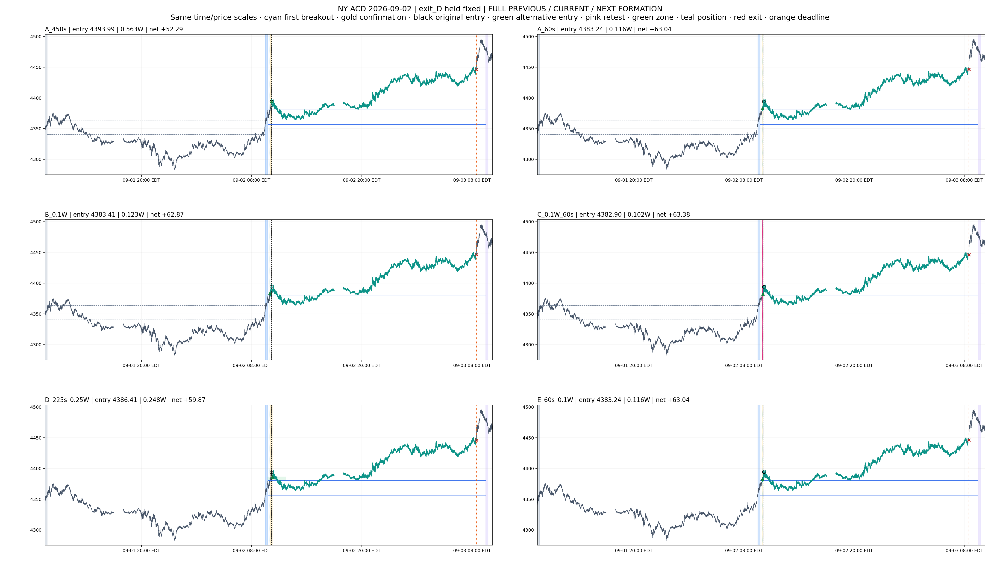

# Trade 2: entry-family comparison, 2026-09-02

The original long enters at 2026-09-02T10:09:50.463-04:00, 4393.99; W=24.02, upper edge=4380.455, lower edge=4356.435. Execution is 0.563W beyond the edge. The original trailing exit at 2026-09-02T10:13:04.682-04:00, 4388.49, loses USD 5.64 net.

Price later returns inside at 2026-09-02T10:47:02.000-04:00, 4380.40. No raw or held opposite break occurs before the deadline. Unrestricted pre-deadline MFE/MAE from the original executed entry are 56.15/29.57; the next-formation unrestricted MFE is 102.08, which includes movement outside the permitted holding period. The structural-only counterfactual exits through timed at 2026-09-03T08:30:00.000-04:00; capital protection does not interrupt that counterfactual before the later move. Its path MFE is 56.15, not a claim of peak execution.

Every alternative below is taken from its complete independent account replay, including preceding profits and capital headroom. Entry chronology, not retrospective swing identification, determines outcomes. Full records include first breakout, retest excursion and return timestamps, structural risk and target already-reached flags.

| Entry profile | Exit | Entry NY | Price | Hold s | Distance W | Exit NY | Price | Reason | Net USD | Top-up |
| --- | --- | --- | --- | --- | --- | --- | --- | --- | --- | --- |
| A_450s | exit_A | 2026-09-02T10:09:50.463-04:00 | 4393.99 | 450.17 | 0.56 | 2026-09-02T10:13:04.682-04:00 | 4388.49 | trailing | -5.64 | 5.64 |
| A_450s | exit_B | 2026-09-02T10:09:50.463-04:00 | 4393.99 | 450.17 | 0.56 | 2026-09-02T21:07:11.136-04:00 | 4398.44 | target | 4.31 | 0.00 |
| A_450s | exit_C | 2026-09-02T10:09:50.463-04:00 | 4393.99 | 450.17 | 0.56 | 2026-09-03T08:30:00.000-04:00 | 4446.42 | timed | 52.29 | 0.00 |
| A_450s | exit_D | 2026-09-02T10:09:50.463-04:00 | 4393.99 | 450.17 | 0.56 | 2026-09-03T08:30:00.000-04:00 | 4446.42 | timed | 52.29 | 0.00 |
| A_60s | exit_A | 2026-09-02T10:00:03.110-04:00 | 4383.24 | 60.00 | 0.12 | 2026-09-02T10:13:04.682-04:00 | 4388.49 | trailing | 5.11 | 0.00 |
| A_60s | exit_B | 2026-09-02T10:00:03.110-04:00 | 4383.24 | 60.00 | 0.12 | 2026-09-02T21:07:11.136-04:00 | 4398.44 | target | 15.06 | 0.00 |
| A_60s | exit_C | 2026-09-02T10:00:03.110-04:00 | 4383.24 | 60.00 | 0.12 | 2026-09-02T21:24:17.873-04:00 | 4396.09 | trailing | 12.71 | 0.00 |
| A_60s | exit_D | 2026-09-02T10:00:03.110-04:00 | 4383.24 | 60.00 | 0.12 | 2026-09-03T08:30:00.000-04:00 | 4446.42 | timed | 63.04 | 0.00 |
| B_0.1W | exit_A | 2026-09-02T09:59:13.755-04:00 | 4383.41 | 10.65 | 0.12 | 2026-09-02T10:13:04.682-04:00 | 4388.49 | trailing | 4.94 | 0.00 |
| B_0.1W | exit_B | 2026-09-02T09:59:13.755-04:00 | 4383.41 | 10.65 | 0.12 | 2026-09-02T21:07:11.136-04:00 | 4398.44 | target | 14.89 | 0.00 |
| B_0.1W | exit_C | 2026-09-02T09:59:13.755-04:00 | 4383.41 | 10.65 | 0.12 | 2026-09-02T21:24:17.873-04:00 | 4396.09 | trailing | 12.54 | 0.00 |
| B_0.1W | exit_D | 2026-09-02T09:59:13.755-04:00 | 4383.41 | 10.65 | 0.12 | 2026-09-03T08:30:00.000-04:00 | 4446.42 | timed | 62.87 | 0.00 |
| C_0.1W_60s | exit_A | 2026-09-02T10:03:20.442-04:00 | 4382.90 | 60.15 | 0.10 | 2026-09-02T10:13:04.682-04:00 | 4388.49 | trailing | 5.45 | 0.00 |
| C_0.1W_60s | exit_B | 2026-09-02T10:03:20.442-04:00 | 4382.90 | 60.15 | 0.10 | 2026-09-02T21:07:11.136-04:00 | 4398.44 | target | 15.40 | 0.00 |
| C_0.1W_60s | exit_C | 2026-09-02T10:03:20.442-04:00 | 4382.90 | 60.15 | 0.10 | 2026-09-02T21:24:18.548-04:00 | 4396.01 | trailing | 12.97 | 0.00 |
| C_0.1W_60s | exit_D | 2026-09-02T10:03:20.442-04:00 | 4382.90 | 60.15 | 0.10 | 2026-09-03T08:30:00.000-04:00 | 4446.42 | timed | 63.38 | 0.00 |
| D_225s_0.25W | exit_A | 2026-09-02T10:15:33.137-04:00 | 4386.41 | 792.85 | 0.25 | 2026-09-02T10:23:34.313-04:00 | 4388.81 | trailing | 2.26 | 0.00 |
| D_225s_0.25W | exit_B | 2026-09-02T10:15:33.137-04:00 | 4386.41 | 792.85 | 0.25 | 2026-09-02T21:07:11.136-04:00 | 4398.44 | target | 11.89 | 0.00 |
| D_225s_0.25W | exit_C | 2026-09-02T10:15:33.137-04:00 | 4386.41 | 792.85 | 0.25 | 2026-09-03T08:30:00.000-04:00 | 4446.42 | timed | 59.87 | 0.00 |
| D_225s_0.25W | exit_D | 2026-09-02T10:15:33.137-04:00 | 4386.41 | 792.85 | 0.25 | 2026-09-03T08:30:00.000-04:00 | 4446.42 | timed | 59.87 | 0.00 |
| E_60s_0.1W | exit_A | 2026-09-02T10:00:03.110-04:00 | 4383.24 | 60.00 | 0.12 | 2026-09-02T10:13:04.682-04:00 | 4388.49 | trailing | 5.11 | 0.00 |
| E_60s_0.1W | exit_B | 2026-09-02T10:00:03.110-04:00 | 4383.24 | 60.00 | 0.12 | 2026-09-02T21:07:11.136-04:00 | 4398.44 | target | 15.06 | 0.00 |
| E_60s_0.1W | exit_C | 2026-09-02T10:00:03.110-04:00 | 4383.24 | 60.00 | 0.12 | 2026-09-02T21:24:17.873-04:00 | 4396.09 | trailing | 12.71 | 0.00 |
| E_60s_0.1W | exit_D | 2026-09-02T10:00:03.110-04:00 | 4383.24 | 60.00 | 0.12 | 2026-09-03T08:30:00.000-04:00 | 4446.42 | timed | 63.04 | 0.00 |

## exit_A

[Entry zoom](charts/zoom_2026-09-02_exit_A.png)

## exit_B

[Entry zoom](charts/zoom_2026-09-02_exit_B.png)

## exit_C

[Entry zoom](charts/zoom_2026-09-02_exit_C.png)

## exit_D

[Entry zoom](charts/zoom_2026-09-02_exit_D.png)